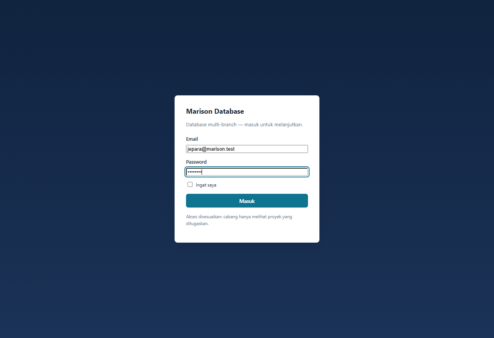
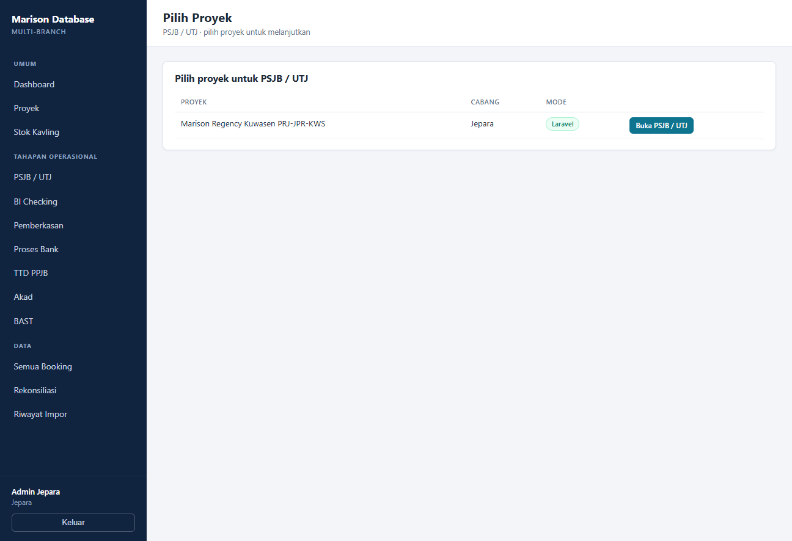
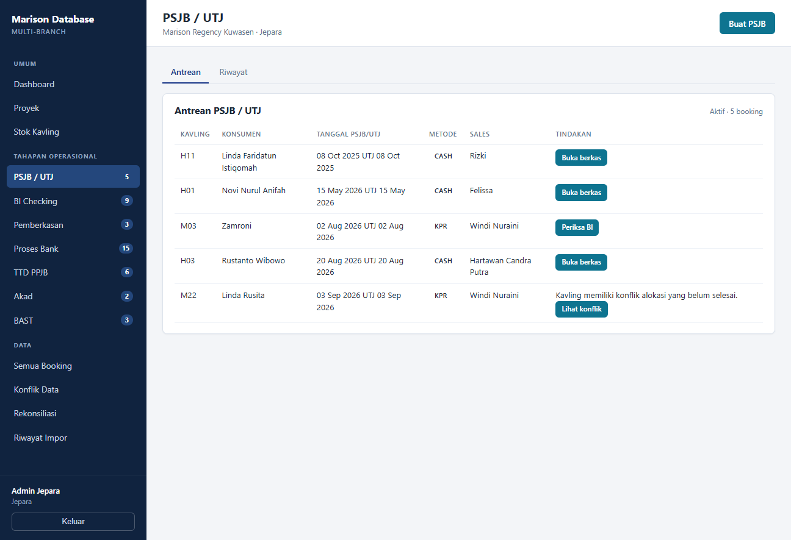
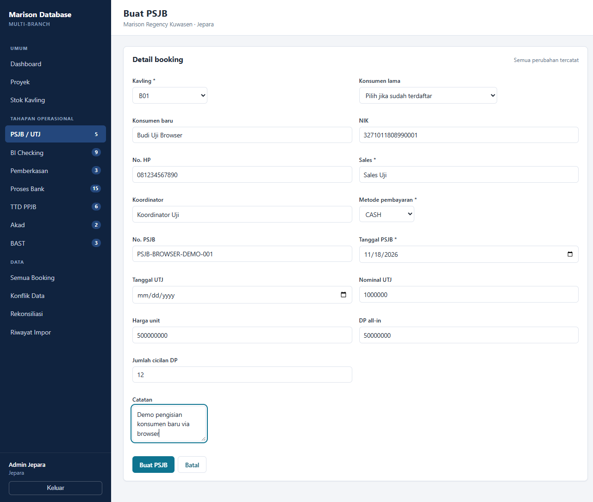

# Alur browser: login → isi konsumen baru

Demo di `http://localhost:8001` dengan `APP_ENV=staging`, `MARISON_OPERATIONAL_WRITES=true`, `MARISON_IMPORT_CONFLICTS_ENABLED=true`. Akun: `jepara@marison.test` / `password` (seed lokal). Form **diisi saja, belum disubmit**.

## 1. Login

Email `jepara@marison.test`, password `password`, klik **Masuk**.

## 2. Dashboard → PSJB / UTJ

Sidebar: **Tahapan Operasional → PSJB / UTJ**. Karena belum ada proyek aktif, aplikasi membuka pemilih proyek.

Pilih **Marison Regency Kuwasen (PRJ-JPR-KWS)** → **Buka PSJB / UTJ**.

## 3. PSJB / UTJ — Antrean

Badge sidebar `PSJB / UTJ 5` sama dengan 5 baris antrean. Tombol **Buat PSJB** muncul karena role branch admin + gate staging aktif. Menu **Konflik Data** juga muncul saat gate konflik aktif.

## 4. Buat PSJB — konsumen baru

Klik **Buat PSJB**. Isian demo:

| Field | Nilai |
|---|---|
| Kavling | B01 |
| Konsumen lama | dikosongkan |
| Konsumen baru | Budi Uji Browser |
| NIK | 3271011808990001 |
| No. HP | 081234567890 |
| Sales | Sales Uji |
| Koordinator | Koordinator Uji |
| Metode pembayaran | CASH |
| No. PSJB | PSJB-BROWSER-DEMO-001 |
| Tanggal PSJB | 2026-11-18 |
| Nominal UTJ | 1000000 |
| Harga unit | 500000000 |
| DP all-in | 50000000 |
| Jumlah cicilan DP | 12 |
| Catatan | Demo pengisian konsumen baru via browser |

Nilai terbaca dari DOM sebelum submit: `buyer_id=""`, `buyer_name="Budi Uji Browser"` — berarti jalur konsumen baru dipakai, bukan konsumen lama.

Belum klik **Buat PSJB**, jadi tidak ada booking/buyer baru yang tersimpan.
